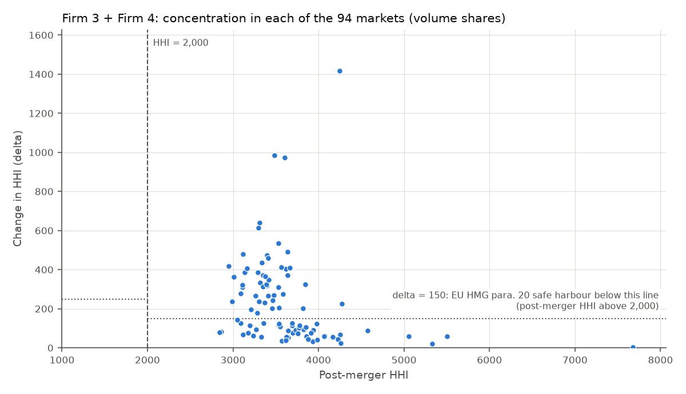
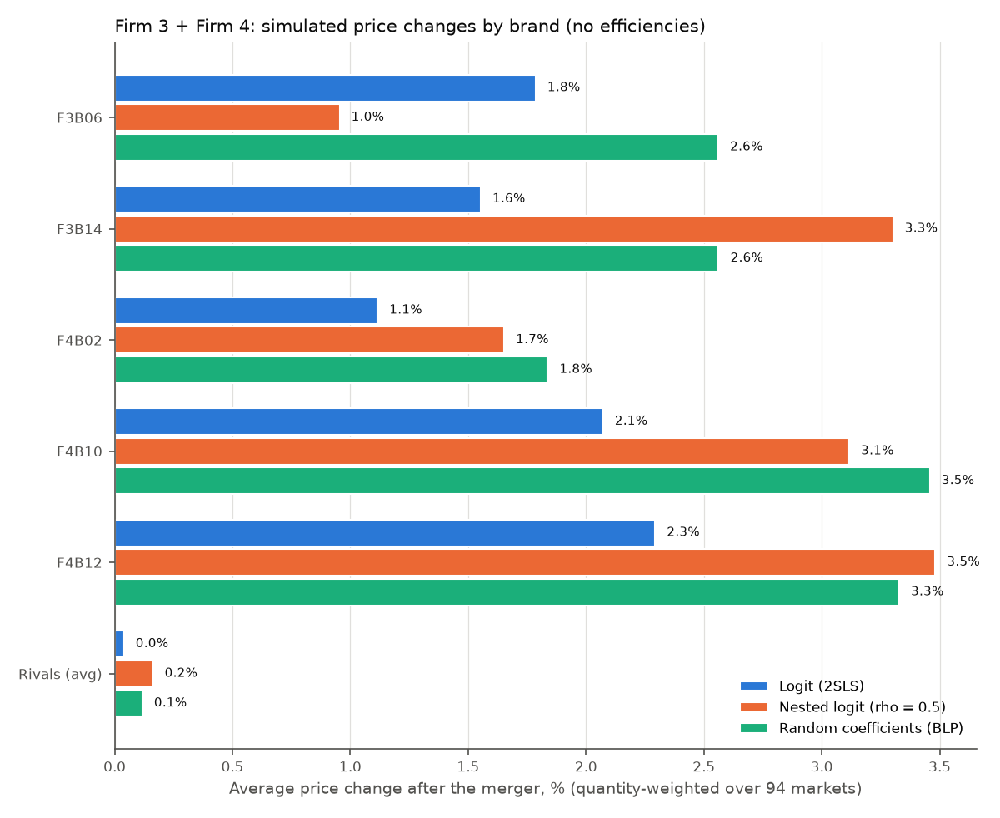
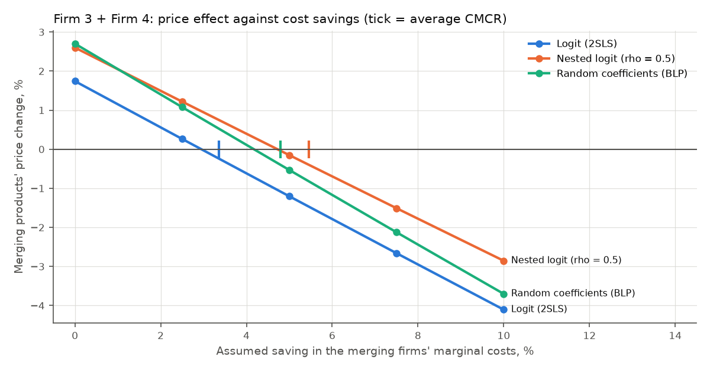

# Merger Simulation

This project screens a hypothetical merger with the standard competition toolkit, then simulates its effect on prices under three demand models:

- market shares, the HHI and its change, checked against the EU and UK merger guidelines;
- critical loss and the hypothetical monopolist (SSNIP) test;
- diversion ratios, upward pricing pressure (UPP) and GUPPIs;
- demand estimation: plain logit (OLS and IV), nested logit, and random-coefficients logit (BLP);
- post-merger Bertrand–Nash prices, consumer surplus, and the compensating marginal-cost reductions that would offset the price rises.

The merger is **hypothetical** and the data are **teaching datasets**, not real market data: see [Data](#data). Every figure below comes from the scripts in `scripts/`, and each cites the output file it comes from. A two-page memo written for a non-technical reader is in [`docs/memo.md`](docs/memo.md).

## The question

Firm 3 and Firm 4 sell ready-to-eat breakfast cereals. Would a merger between them lead to materially higher prices? Firm 1 + Firm 2, a much larger combination, is run through the same tools as a point of comparison.

## Data

Both datasets ship with [pyblp](https://pyblp.readthedocs.io) 1.3.0, so nothing is downloaded.

| Dataset | What it is | Size | Used for |
|---|---|---|---|
| Cereal | The "fake cereal" data of Nevo (2000a), from Nevo's Matlab code as archived on Eric Rasmusen's website. That archive says the data "were motivated by real scanner data, but it is not real and should not be used to make any inference". | 24 brands in 94 markets (47 cities × 2 quarters); 5 firms with anonymous IDs | Everything: screening, demand, simulation |
| Automobiles | The data of Berry, Levinsohn and Pakes (1995), as extracted by Andrews, Gentzkow and Shapiro (2017) from the original BLP code | 2,217 model-years, 20 annual US markets (1971–1990), 26 firms | Only the OLS-versus-IV comparison |

Each cereal file comes with Nevo's 20 pre-computed excluded instruments for price, and 20 simulated consumers per market with demographics (income, income squared, age, a child dummy). The auto file comes with BLP's "sums of characteristics" instruments. Firm and brand IDs in the cereal data are anonymous, so "Firm 3" is not a real company. The data do not include market sizes (populations), so every average across markets weights the 94 markets equally.

## Screening

### Shares and concentration

Shares and HHIs are computed in SQL (DuckDB) from the 24 brands in each city-quarter. Volume is servings and value is servings × price ([`results/firm_shares.csv`](results/firm_shares.csv)):

| Firm | Brands | Volume share, mean over markets | Range across markets | Value share |
|---|---|---|---|---|
| Firm 1 | 9 | 41.2% | 17.0–87.0% | 40.6% |
| Firm 2 | 9 | 33.3% | 10.3–54.5% | 34.0% |
| Firm 4 | 3 | 11.0% | 1.4–26.7% | 10.3% |
| Firm 3 | 2 | 10.4% | 1.1–41.6% | 10.9% |
| Firm 6 | 1 | 4.0% | 0.1–18.2% | 4.3% |

Concentration by volume ([`results/concentration_summary.csv`](results/concentration_summary.csv), [`results/eu_hmg_classification.csv`](results/eu_hmg_classification.csv)):

| | Firm 3 + Firm 4 | Firm 1 + Firm 2 |
|---|---|---|
| Combined share, mean (range) | 21.5% (2.4–58.6%) | 74.5% (40.2–97.3%) |
| Markets with combined share ≥ 25% | 36 of 94 | 94 of 94 |
| HHI before → after, mean over markets | 3,408 → 3,644 | 3,408 → 5,993 |
| ΔHHI, mean (range) | 236 (3–1,417) | 2,584 (808–4,017) |
| Markets inside an EU HHI safe harbour | 47 of 94 | 0 of 94 |

**EU Horizontal Merger Guidelines** (OJ C 31, 5.2.2004). A combined share below 25% is an indication that a merger is compatible. Concerns are unlikely where the post-merger HHI is above 2,000 and the delta below 150 (para. 20). These levels are an initial indicator and create no presumption either way. Every market is above 2,000, so the delta decides. For Firm 3 + Firm 4, 47 markets fall in the para. 20 safe harbour. Another 11 are outside it but have a combined share below 25%. The remaining 36 are outside both. For Firm 1 + Firm 2, no market is in a safe harbour, and in 26 markets one party alone has 50% or more, which the guidelines list as a special circumstance. A draft of new EU merger guidelines was published in April 2026; the 2004 notice applies until it is adopted.

**CMA Merger Assessment Guidelines** (CMA129). The current guidelines state that "the CMA does not apply any thresholds to market share, number of remaining competitors or on any other measure". The same figures therefore feed into the UK assessment as evidence on closeness of competition, with no bright line to pass or fail.



The mean of the 94 market HHIs (3,408) is higher than the HHI of the average shares (3,053), because concentration varies across cities. On average shares, the delta is 231.

### Critical loss

A hypothetical monopolist raising price by X with a margin M breaks even if it loses a fraction X / (X + M) of its sales (Harris and Simons, 1989). For a 5% SSNIP that is 14.3% of sales at a 30% margin and 11.1% at 40% ([`results/critical_loss.csv`](results/critical_loss.csv)). The test against estimated demand is in [Hypothetical monopolist test](#hypothetical-monopolist-test).

### GUPPIs before any demand estimation

A first screen needs diversion ratios and margins. Here diversion is assumed proportional to the other brands' shares, with a stated fraction of lost sales leaving cereal altogether, and every brand is given the same stated margin. The GUPPIs are revenue-weighted over each firm's brands and averaged over markets ([`results/guppi_screen.csv`](results/guppi_screen.csv)):

| Lost sales leaving cereal | Margin | Firm 3 GUPPI | Firm 4 GUPPI |
|---|---|---|---|
| 0% | 35% | 3.7% | 4.3% |
| 25% | 35% | 2.8% | 3.3% |
| 50% | 35% | 1.8% | 2.2% |
| 25% | 50% | 3.9% | 4.7% |

Across the whole grid (0–50% outside diversion, 20–50% margins) the GUPPIs range from 1.1% to 6.2%. The guidelines set no GUPPI threshold, so these numbers indicate the size of the pricing incentive; they are not a pass or fail.

## Demand estimation

All three models start from Berry's (1994) inversion: with logit errors, ln(s_j) − ln(s_0) is linear in price and characteristics, so demand can be estimated by linear regression. The price coefficient is the parameter that matters most for merger effects.

### Why instruments matter

Price is set by firms that see the product's unobserved quality, so OLS confuses "high price" with "high quality" and makes demand look less price-sensitive than it is ([`results/demand_estimates.csv`](results/demand_estimates.csv), [`results/elasticities_summary.csv`](results/elasticities_summary.csv)):

| Data | Specification | Price coefficient (SE) | First-stage F | Products with inelastic demand | Implied cost ≤ 0 |
|---|---|---|---|---|---|
| Autos | Logit, OLS | −0.089 (0.004) | | 1,502 of 2,217 | 1,524 |
| Autos | Logit, IV | −0.134 (0.012) | 36 | 775 of 2,217 | 809 |
| Cereal | Logit, no brand FE, OLS | −10.1 (0.8) | | 414 of 2,256 | 917 |
| Cereal | Logit, no brand FE, IV | −11.2 (0.8) | 6,431 | 230 of 2,256 | 612 |
| Cereal | Logit, brand FE, OLS | −28.9 (1.0) | | 0 | 1 |
| Cereal | Logit, brand FE, IV | −30.1 (1.0) | 2,790 | 0 | 1 |

A profit-maximising firm never prices where demand is inelastic, so every inelastic product is evidence that the price coefficient is too small.

- **Autos.** This is the textbook case. OLS leaves two-thirds of models with inelastic demand. IV raises the price coefficient by half and halves the number of inelastic products, but with a plain logit 775 remain.
- **Cereal.** Brand fixed effects do most of the work. They absorb each brand's unobserved quality, which is the source of the bias, and on their own they nearly triple the price coefficient. Once they are included, IV moves the coefficient only from −28.9 to −30.1. Nevo's instruments are very strong (first-stage F of 2,790), so weak instruments are not the reason.

Standard errors are heteroskedasticity-robust (HC1). Nevo's instruments are used as distributed; their exclusion restriction is not tested here.

### Nested logit

Logit forces substitution to follow market shares. Nested logit lets brands in the same group compete more closely. The only grouping in the data is `mushy` (brands that go soggy in milk): 8 mushy and 16 crunchy brands.

The nesting parameter ρ is poorly identified in these data. Unconstrained 2SLS estimates of ρ ([`results/nested_logit_identification.csv`](results/nested_logit_identification.csv)):

| Controls | Instruments | ρ (SE) | Price coefficient | Admissible? |
|---|---|---|---|---|
| Brand FE | Nevo's 20 | 1.18 (0.08) | +2.6 | No |
| Brand FE | Nevo's 20 + their averages over the other brands in the nest | 0.54 (0.05) | −15.3 | Yes |
| Brand FE | Those averages only (first-stage F 2.5) | 0.89 (0.19) | −69.2 | Yes, but weak |
| Constant only | Nevo's 20 | 0.50 (0.04) | −4.5 | Yes |
| Constant, sugar, mushy | Nevo's 20 | 1.15 (0.05) | +0.3 | No |

ρ must lie between 0 and 1, and the price coefficient must be negative, for the model to be consistent with utility maximisation. The estimate moves from 0.50 to 1.18 with the specification. ρ is therefore **fixed at 0.5 as a judgement**, close to the one admissible, well-instrumented estimate with brand fixed effects (0.54), with 0.25 and 0.75 as sensitivities. The price coefficient is then re-estimated by IV for each value: −23.2, −16.2 and −9.3 ([`results/demand_estimates.csv`](results/demand_estimates.csv)).

### Random-coefficients logit (BLP)

This is Nevo's specification, estimated by one-step GMM in pyblp. The linear part is price plus brand fixed effects. Random coefficients on the constant, price, sugar and mushy are interacted with income, income squared, age and the child dummy. It reproduces pyblp's tutorial: mean price coefficient −62.7 (SE 14.8). Price sensitivity falls with income: the price × income interaction is +588 (SE 270). Because consumers differ, brands with similar characteristics are closer substitutes than their shares alone imply.

### Elasticities and margins

Pre-merger margins come from assuming that observed prices are a Bertrand–Nash equilibrium, i.e. each firm prices all its brands jointly to maximise profit. Medians over all 2,256 brand-markets ([`results/elasticities_summary.csv`](results/elasticities_summary.csv)):

| Model | Own-price elasticity | Cross-price elasticity | Diversion to outside good | Margin (p − c)/p | Implied cost ≤ 0 |
|---|---|---|---|---|---|
| Logit (IV, brand FE) | −3.65 | 0.042 | 54.4% | 31.5% | 1 |
| Nested logit (ρ = 0.5) | −3.84 | 0.053 | 28.0% | 33.0% | 13 |
| Random coefficients | −3.61 | 0.053 | 35.1% | 33.7% | 4 |

The three models agree on own-price elasticities and margins, but not on where lost sales go. Logit sends over half of them to the outside good (not buying cereal), because under logit diversion follows shares and the outside good is the largest "product". Nested logit and BLP keep more of them within cereal, which raises the diversion between merging brands. All the non-positive implied costs belong to Firm 1 or Firm 2 brands, none to Firm 3 or Firm 4.

## Merger simulation

For each of the 94 markets, costs are recovered from the pre-merger first-order conditions. Ownership is then changed, and the new Bertrand–Nash prices are solved, with costs held fixed. Averages over brands are weighted by pre-merger quantity. Consumer surplus is the logit log-sum, and its change is expressed as a percentage of pre-merger spending on cereal. Main results, no efficiencies ([`results/merger_summary.csv`](results/merger_summary.csv)):

| Firm 3 + Firm 4 | Logit | Nested logit (ρ = 0.5) | Random coefficients |
|---|---|---|---|
| Merging brands' price change | +1.7% | +2.6% | +2.7% |
| Rivals' price change | +0.04% | +0.16% | +0.12% |
| Largest single brand-market rise | +12.6% | +20.7% | +18.8% |
| Consumer surplus change, % of spending | −0.35% | −0.60% | −0.58% |
| GUPPI at pre-merger prices | 1.8% | 2.7% | 2.5% |
| Compensating marginal-cost reduction | 3.4% | 5.5% | 4.8% |



- **The price effect is modest.** It is about 2–3% on the merging brands under the two richer models, and smaller under logit, whose diversion to the outside good is the highest. Averages hide wide variation across cities: in single markets, individual brands rise by up to 13–21% ([`results/merger_by_product.csv`](results/merger_by_product.csv)).
- **Nested logit is driven by the nests.** Under nested logit, F3B06, Firm 3's only mushy brand, rises least (+1.0%), because none of Firm 4's brands is mushy. Under BLP, both Firm 3 brands rise by 2.6%.
- **GUPPIs track the simulated rises.** Using the models' own diversion ratios and margins, the GUPPIs are 1.8–2.7% against simulated rises of 1.7–2.7%. All three sit inside the 1.1–6.2% range of the share-based screen.
- **Rivals gain more than the merging firms.** Rivals raise prices a little and win share. Under logit their profits rise by 0.15% of spending and the merging firms' by 0.02%. Consumers lose 0.35%. The pattern is the same under the other two models.

**Compensating marginal-cost reductions** (Werden, 1996) are the cost savings on the merging brands that would leave all prices unchanged after the merger. They average 3.4–5.5% of marginal cost, quantity-weighted over brands with positive costs. A 5% saving on all the merging brands would more than offset the average price rise under every model ([`results/sensitivity.csv`](results/sensitivity.csv)):



**For comparison, Firm 1 + Firm 2** raises the merging brands' prices by 7.0% (logit), 15.0% (nested logit) and 12.8% (BLP). Consumers lose 4.5–9.4% of spending. The median compensating cost reduction is 13–33%, an implausible efficiency.

### Hypothetical monopolist test

Is "all 24 cereal brands in a city-quarter" a relevant market? A monopolist of all 24 brands raises every price by 5%; costs are those recovered above ([`results/hmt.csv`](results/hmt.csv)):

| Model | Average margin | Critical loss | Actual loss | Markets where the SSNIP is profitable |
|---|---|---|---|---|
| Logit | 33.5% | 13.1% | 9.5% | 94 of 94 |
| Nested logit (ρ = 0.5) | 37.2% | 12.1% | 5.1% | 94 of 94 |
| Random coefficients | 36.5% | 12.2% | 6.7% | 94 of 94 |

The candidate market passes the test under all three models. A 10% SSNIP is profitable in 90 of 94 markets under logit and in all 94 under the other two. So the relevant market is no wider than cereal in a city-quarter: other foods (the outside good) need not be included. Whether a narrower market, such as a segment of cereals, would also pass was not tested. The CMA's guidelines describe market definition as "not an end in itself", and the simulation measures the loss of competition between the parties directly.

## Robustness

Merging brands' average price change under alternative assumptions ([`results/sensitivity.csv`](results/sensitivity.csv)):

| Check | Setting | Logit | Nested logit | Random coefficients |
|---|---|---|---|---|
| Central case | | +1.7% | +2.6% | +2.7% |
| Nesting parameter | ρ = 0.25 / 0.75 | | +2.2% / +2.8% | |
| Logit price coefficient | 95% CI bounds (−28.1 / −32.1) | +1.9% / +1.6% | | |
| Market size | 0.75× | +2.4% | +2.9% | |
| Market size | 1.5× | +1.1% | +2.3% | |
| Efficiencies | merging firms' costs −2.5% | +0.3% | +1.2% | +1.1% |
| Efficiencies | merging firms' costs −5% | −1.2% | −0.2% | −0.5% |

The **market size** matters as much as the choice of demand model. Defining the potential market as larger makes the outside good bigger, so more lost sales leave cereal. The BLP model was not re-estimated for the market-size check.

## Checks against pyblp

The BLP merger simulation uses this package's own share function, Jacobian, cost recovery and equilibrium solver, with pyblp's estimated parameters and simulated consumers. pyblp's post-estimation routines give the same answers ([`results/pyblp_check.csv`](results/pyblp_check.csv)):

| Quantity | Largest absolute difference | Typical size |
|---|---|---|
| Marginal costs | 4.2e−16 | 0.081 |
| Post-merger prices | 1.0e−11 | 0.124 |
| Own-price elasticities | 3.5e−14 | 3.6 |
| Consumer surplus, after the merger | 1.9e−13 | 0.031 |

## Design

```
load_cereal / load_autos (pyblp's CSV files)
        │
        ├──> ShareTable (DuckDB, SQL): firm shares, HHI, delta, by market ──> eu_hmg_indication()
        │
        ├──> estimate_logit / estimate_nested_logit (2SLS on Berry's inversion)
        │    estimate_rc_nevo (pyblp GMM)
        │            │
        │            ▼
        │    FittedDemand (abstract) ─┬─ LogitFit          .market(id) returns one market's DemandModel
        │                             ├─ NestedLogitFit
        │                             └─ RCFit
        │
DemandModel (abstract) ─┬─ LogitDemand                shares(p), jacobian(p), consumer_surplus(p)
                        ├─ NestedLogitDemand          (elasticities and diversion come from the Jacobian)
                        └─ RandomCoefficientsDemand
                │
                ▼
BertrandNash (demand, ownership): markups, recover_costs, solve; compensating_cost_reductions()
                │
                ▼
Merger (which firms combine) ──> MergerSimulator (one fit, one merger) ──> SimulationResult (by product, firm, market)
```

Each class has one job and a small public interface; the docstrings explain why it exists.

- **`DemandModel` asks only three questions:** shares, the Jacobian and consumer surplus at given prices. The equilibrium solver, diversion ratios and welfare code use nothing else. A new demand system therefore only needs those three methods.
- **`FittedDemand` turns estimates for all markets into one `DemandModel` per market.** The simulator treats logit, nested logit and BLP the same way.
- **`BertrandNash` holds one demand model and one ownership matrix.** A merger is just a different ownership matrix.
- **`Merger` is a small immutable record of which firms combine.** It builds the ownership matrices before and after.
- **`ShareTable` keeps the product data in DuckDB.** Every share and HHI table is one SQL query.

## How to run

```bash
python -m venv .venv && source .venv/bin/activate
pip install -e ".[dev]"
pytest                          # 54 tests on synthetic data, no network needed
python scripts/run_screening.py # shares, HHI, EU bands, critical loss, GUPPI screen → results/
python scripts/run_demand.py    # logit, nested logit, BLP estimates and elasticities → results/
python scripts/run_merger.py    # simulation, HMT, sensitivity, pyblp check → results/ (about 1.5 minutes)
```

**What the tests check:**

- HHI and ΔHHI arithmetic, and that the SQL tables reproduce it;
- the EU guideline bands;
- the critical-loss formula and that it is the break-even point;
- UPP and GUPPI arithmetic;
- that Berry's inversion recovers the mean utilities, for logit and nested logit;
- logit own- and cross-price elasticities against the closed form;
- every model's Jacobian against finite differences, and Roy's identity for consumer surplus;
- that the solver reproduces observed prices from recovered costs, under all three models;
- that compensating cost reductions restore pre-merger prices, and Werden's closed form for two symmetric firms;
- that 2SLS removes a known endogeneity bias in simulated data;
- that the solver converges in a market where the plain markup iteration cycles.

## Limitations

- **The data are not real.** Nevo's cereal data are semi-fabricated teaching data, and the firm IDs are anonymous. The numbers show how the method behaves, not what any real merger would do.
- **Static Bertrand pricing with constant marginal costs.** There is no entry, repositioning, capacity constraint, coordination, or retailer behaviour. Recovered costs are only as good as the assumption that pre-merger prices are a Nash equilibrium. A handful of brand-markets imply non-positive costs, which is evidence against that assumption there.
- **The nesting parameter is assumed, not estimated.** Nested-logit results depend on ρ and on the mushy/crunchy grouping, the only grouping in the data.
- **Market size is assumed.** The outside good's share comes from the market-size definition in the data, and results move with it (see [Robustness](#robustness)).
- **No market weights.** Populations are not in the data, so averages weight every city-quarter equally.
- **Efficiencies are hypothetical.** The cost reductions are what-ifs. The CMA and the Commission credit only efficiencies that are verifiable, merger-specific and likely to benefit customers.
- **Autos are used only for the IV illustration.** BLP random coefficients and a supply side were not estimated on them.

## References

- Berry, S. (1994). Estimating discrete-choice models of product differentiation. *RAND Journal of Economics*.
- Berry, S., Levinsohn, J. and Pakes, A. (1995). Automobile prices in market equilibrium. *Econometrica*.
- Conlon, C. and Gortmaker, J. (2020). Best practices for differentiated products demand estimation with PyBLP. *RAND Journal of Economics*.
- Competition and Markets Authority (2021, updated). Merger assessment guidelines (CMA129).
- European Commission (2004). Guidelines on the assessment of horizontal mergers. OJ C 31, 5.2.2004.
- Farrell, J. and Shapiro, C. (2010). Antitrust evaluation of horizontal mergers: an economic alternative to market definition. *B.E. Journal of Theoretical Economics*.
- Harris, B. and Simons, J. (1989). Focusing market definition: how much substitution is necessary? *Research in Law and Economics*.
- Nevo, A. (2000a). A practitioner's guide to estimation of random-coefficients logit models of demand. *Journal of Economics & Management Strategy*.
- Werden, G. (1996). A robust test for consumer welfare enhancing mergers among sellers of differentiated products. *Journal of Industrial Economics*.
